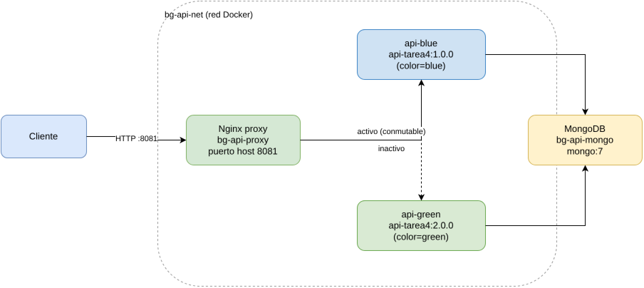
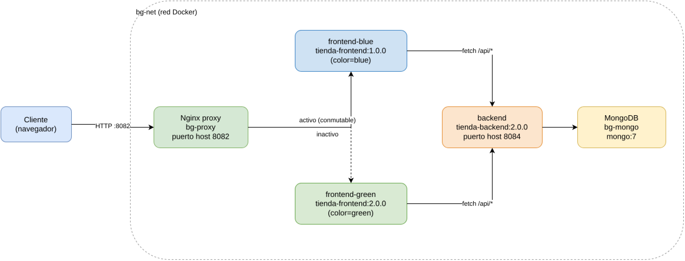

# Informe Técnico: Estrategia de Despliegue Blue-Green con Docker

**Curso:** Desarrollo Web — Universidad Mariano Gálvez
**Tarea:** 6 — Estrategias de despliegue de aplicaciones web con Docker
**Aplicaciones base:** Tarea 4 (API Express + MongoDB) y Tarea 5 (TecnoCore Guatemala: frontend React + backend Express/MongoDB)
**Fecha:** 22 de octubre de 2026

---

## Índice

1. [Introducción](#1-introducción)
2. [Objetivos](#2-objetivos)
3. [Aplicaciones base](#3-aplicaciones-base)
4. [Estrategia seleccionada: Blue-Green Deployment](#4-estrategia-seleccionada-blue-green-deployment)
5. [Arquitectura de la implementación](#5-arquitectura-de-la-implementación)
6. [Configuración utilizada](#6-configuración-utilizada)
7. [Comandos documentados](#7-comandos-documentados)
8. [Evidencia de funcionamiento](#8-evidencia-de-funcionamiento)
9. [Limitaciones y riesgos de Blue-Green](#9-limitaciones-y-riesgos-de-blue-green)
10. [Reproducibilidad en otro equipo](#10-reproducibilidad-en-otro-equipo)
11. [Conclusiones](#11-conclusiones)
12. [Recomendaciones](#12-recomendaciones)
13. [Anexo: estructura del repositorio](#13-anexo-estructura-del-repositorio)

---

## Resumen ejecutivo

Este informe documenta la implementación, con contenedores Docker reales, de la estrategia de despliegue **Blue-Green Deployment**, aplicada sobre dos aplicaciones distintas desarrolladas previamente en el curso:

1. La **API REST de la Tarea 4** (Node.js/Express + MongoDB).
2. La aplicación completa de la **Tarea 5** ("TecnoCore Guatemala"): un frontend React (Vite) y un backend Express/MongoDB con autenticación JWT y catálogo de productos.

Para cada una de las dos aplicaciones se construyeron dos versiones de imagen Docker (`v1`/*blue* y `v2`/*green*), se desplegaron **simultáneamente** en contenedores independientes, y se usó **Nginx** como *proxy* que dirige el tráfico hacia uno u otro entorno. El cambio de versión se realiza reemplazando la configuración activa de Nginx y recargándola (`nginx -s reload`), sin detener ningún contenedor.

Se incluye, en todos los casos, **evidencia real** capturada durante la ejecución (listados de contenedores, respuestas HTTP, mediciones de disponibilidad continua durante el cambio de versión), no solo explicación teórica.

> **Nota sobre el alcance:** la consigna de la actividad permite elegir **tres** de cuatro estrategias (Recreate, Blue-Green, Canary, Rolling). Durante el desarrollo se construyeron y probaron exitosamente las tres estrategias seleccionadas inicialmente (Recreate, Blue-Green y Canary, con evidencia de funcionamiento para las tres). Por decisión explícita del estudiante, el entregable final se redujo a **una sola estrategia: Blue-Green**, aplicada en dos escenarios distintos (API de Tarea 4 y aplicación completa de Tarea 5) para seguir usando ambos proyectos base. La sección 4.2 describe, a nivel teórico, en qué se diferencian Recreate, Canary y Rolling respecto a Blue-Green, a modo de contexto comparativo, pero **no fueron implementadas** en esta entrega.

---

## 1. Introducción

Cuando una aplicación web pasa de una versión a otra en producción, la forma en que se realiza ese cambio (la *estrategia de despliegue*) determina si los usuarios perciben una interrupción del servicio, si es posible revertir rápidamente ante un error, y qué tan arriesgado es el cambio. Docker permite empaquetar cada versión de una aplicación como una imagen inmutable y versionada, lo que facilita experimentar con distintas estrategias de despliegue de forma reproducible, incluso en un equipo de desarrollo local.

Este informe toma dos aplicaciones ya construidas en el curso:

- **Tarea 4**: una API REST mínima en Express conectada a MongoDB.
- **Tarea 5**: una aplicación de comercio electrónico ("TecnoCore Guatemala") con frontend en React (Vite + React Router + React Bootstrap) y backend en Express con autenticación JWT, catálogo de productos y conexión a MongoDB.

y las empaqueta en imágenes Docker versionadas, para desplegarlas con la estrategia **Blue-Green**.

## 2. Objetivos

- Documentar e implementar, con Docker real, la estrategia de despliegue Blue-Green sobre dos aplicaciones distintas.
- Explicar su funcionamiento y justificar su selección frente a las demás alternativas.
- Evidenciar, con comandos y mediciones reales, que el cambio de versión no genera tiempo de indisponibilidad perceptible.
- Documentar las limitaciones y riesgos de la estrategia.
- Dejar una implementación reproducible en cualquier equipo con Docker instalado, sin exponer credenciales.

## 3. Aplicaciones base

### 3.1 Tarea 4 — API REST (Express + MongoDB)

Ubicación original: `Tarea 4/`. Es una API mínima que expone:

- `GET /` → redirige a `/api/v1`.
- `GET /api/v1` → responde el estado de la API y si detecta la variable `MONGODB_URI`.

Para esta tarea se copió el proyecto a `apps/api-tarea4/` y se le agregó **instrumentación mínima y aditiva** (sin alterar su lógica original) para poder evidenciar qué versión/instancia responde en cada momento:

- Variables de entorno `APP_VERSION` y `APP_COLOR` (inyectadas en la imagen vía `ARG`/`ENV` del Dockerfile).
- Endpoint `GET /health` con el estado, versión y color de la instancia.
- El endpoint `GET /api/v1` ahora también devuelve `version`, `color`, `instance` y el estado de conexión a la base de datos (`db`).

### 3.2 Tarea 5 — "TecnoCore Guatemala" (React + Express + MongoDB)

Proyecto obtenido de la rama `Tarea5` del repositorio del curso (`backend/` + frontend en la raíz). Es una tienda en línea con:

- Catálogo de productos (`GET /api/recursos`, público).
- Autenticación de usuarios con JWT (`/api/auth`).
- Panel de administración de productos (requiere rol admin).
- Frontend en React (Vite) que consume la API mediante `fetch` (`src/services/api.js`), usando la variable de build `VITE_API_URL`.

Se copió a `apps/tienda-tarea5/{backend,frontend}/` y se agregó la misma instrumentación aditiva:

- Backend: endpoint `GET /api/version` con `version`, `color`, `instance`.
- Frontend: componente `VersionBadge.jsx`, una insignia flotante que muestra la versión/color activos, agregada al `Layout.jsx` general. Lee las variables `VITE_APP_VERSION` / `VITE_APP_COLOR`, horneadas en el *bundle* en tiempo de build.

**Ninguna credencial real (cadenas de conexión de MongoDB Atlas, JWT secrets) fue copiada al repositorio.** Cada app incluye un `.env.example` documentado; en los entornos Docker, los contenedores de MongoDB usados son instancias locales sin autenticación, exclusivamente para fines de demostración.

## 4. Estrategia seleccionada: Blue-Green Deployment

### 4.1 Fundamento teórico

En Blue-Green se mantienen **dos entornos completos y productivos en paralelo**: el entorno activo ("blue", versión actual) y el entorno preparado con la nueva versión ("green"). Ambos corren simultáneamente; el cambio de tráfico de uno a otro se realiza en un punto único de enrutamiento (en este caso, Nginx), de forma prácticamente instantánea. Si la nueva versión falla, basta con volver a apuntar el tráfico al entorno anterior (*rollback* inmediato), que sigue disponible y sin reiniciar.

**Por qué se eligió:** permite demostrar de forma clara y medible la propiedad más valiosa de Blue-Green — *cero tiempo de inactividad durante el cambio* — comparándola directamente contra el comportamiento por defecto de un despliegue simple (Recreate), que sí genera una ventana de corte. Es además la estrategia más simple de implementar con herramientas ya disponibles (Docker Compose + Nginx) sin necesitar un orquestador como Kubernetes.

### 4.2 Comparación teórica frente a las demás estrategias (contexto, no implementadas)

| Estrategia | Mecanismo | Tiempo de indisponibilidad | Complejidad | Rollback |
|---|---|---|---|---|
| **Recreate** | Se detiene la versión actual y se levanta la nueva en su lugar. | Sí, durante el intervalo en que no hay ningún contenedor activo (en nuestra prueba inicial con `docker compose up -d` tras cambiar la etiqueta de imagen, se midieron ~0.6 s de fallos consecutivos). | Muy baja. | Lento: hay que volver a desplegar la versión anterior. |
| **Blue-Green** *(implementada)* | Dos entornos completos corren en paralelo; se conmuta el tráfico en el proxy. | No, el entorno nuevo ya está "caliente" antes del cambio. | Media (el doble de recursos mientras ambos entornos coexisten). | Inmediato: se revierte el proxy al entorno anterior. |
| **Canary** | La nueva versión recibe solo un porcentaje del tráfico, que se incrementa gradualmente. | No, pero expone a una fracción de usuarios a la versión nueva antes de confirmarla. | Media-alta (requiere métricas por versión para decidir si ampliar o revertir el porcentaje). | Rápido: basta con bajar el porcentaje a 0%. |
| **Rolling** | Las instancias de la versión anterior se sustituyen una por una por instancias de la nueva. | Parcial/mínima: siempre hay capacidad total, pero coexisten ambas versiones durante la transición. | Media-alta (requiere múltiples réplicas y un balanceador consciente de salud). | Progresivo: hay que revertir instancia por instancia. |

Blue-Green y Canary comparten el principio de "tener la nueva versión lista antes de exponerla", pero Blue-Green conmuta el 100% del tráfico de una sola vez, mientras que Canary lo hace de forma gradual y medida. Rolling, en cambio, no mantiene dos entornos completos: sustituye instancias de un mismo *pool*, por lo que durante la transición ambas versiones conviven atendiendo tráfico simultáneamente sin que el operador lo controle explícitamente por proxy.

## 5. Arquitectura de la implementación

Se construyeron **tres pares de imágenes versionadas** (una por aplicación/componente), con el mismo patrón de etiquetado semántico `v1.0.0` ("blue") y `v2.0.0` ("green"):

```
api-tarea4:1.0.0        (blue)      api-tarea4:2.0.0        (green)
tienda-backend:1.0.0    (blue)      tienda-backend:2.0.0    (green)
tienda-frontend:1.0.0   (blue)      tienda-frontend:2.0.0   (green)
```

Se implementaron **dos escenarios Blue-Green independientes**, cada uno con su propio `docker-compose.yml`, para usar ambas aplicaciones base:

### 5.1 Escenario A — `despliegues/blue-green-api-tarea4/`

Diagrama elaborado en **draw.io** (fuente editable en [`docs/diagramas/escenario-a-api.drawio`](docs/diagramas/escenario-a-api.drawio), exportado a PNG de forma reproducible con `docker run --rm -v "$PWD:/data" rlespinasse/drawio-export -f png`):



### 5.2 Escenario B — `despliegues/blue-green-frontend-tarea5/`

Diagrama elaborado en **draw.io** (fuente editable en [`docs/diagramas/escenario-b-frontend.drawio`](docs/diagramas/escenario-b-frontend.drawio), exportado con el mismo procedimiento):



> En el escenario B solo el **frontend** está en Blue-Green (es el componente cuya versión se está cambiando); el backend corre como una sola instancia porque en este escenario representa el servicio estable del que ambas versiones del frontend dependen. El Escenario A, en cambio, aplica Blue-Green sobre la **API**, demostrando que la misma técnica funciona igual de bien en un servicio sin interfaz.

## 6. Configuración utilizada

### 6.1 Dockerfile — `apps/api-tarea4/Dockerfile`

```dockerfile
FROM node:20-alpine
WORKDIR /app
COPY package.json ./
RUN npm install --omit=dev
COPY . .
ENV PORT=3000
EXPOSE 3000
ARG APP_VERSION=1.0.0
ARG APP_COLOR=blue
ENV APP_VERSION=${APP_VERSION}
ENV APP_COLOR=${APP_COLOR}
CMD ["node", "server.js"]
```

### 6.2 Dockerfile — `apps/tienda-tarea5/backend/Dockerfile`

```dockerfile
FROM node:20-alpine
WORKDIR /app
COPY package.json ./
RUN npm install --omit=dev
COPY src ./src
ENV PORT=4000
EXPOSE 4000
ARG APP_VERSION=1.0.0
ARG APP_COLOR=blue
ENV APP_VERSION=${APP_VERSION}
ENV APP_COLOR=${APP_COLOR}
CMD ["node", "src/server.js"]
```

### 6.3 Dockerfile multi-stage — `apps/tienda-tarea5/frontend/Dockerfile`

```dockerfile
# Etapa 1: build de la SPA con Vite
FROM node:20-alpine AS build
WORKDIR /app
COPY package.json ./
RUN npm install
COPY . .
ARG VITE_API_URL=http://localhost:4000/api
ARG VITE_APP_VERSION=1.0.0
ARG VITE_APP_COLOR=blue
ENV VITE_API_URL=${VITE_API_URL}
ENV VITE_APP_VERSION=${VITE_APP_VERSION}
ENV VITE_APP_COLOR=${VITE_APP_COLOR}
RUN npm run build

# Etapa 2: servir los archivos estáticos con Nginx
FROM nginx:1.27-alpine
COPY nginx.conf /etc/nginx/conf.d/default.conf
COPY --from=build /app/dist /usr/share/nginx/html
EXPOSE 80
CMD ["nginx", "-g", "daemon off;"]
```

El uso de *build args* (`VITE_APP_VERSION`, `VITE_APP_COLOR`, `VITE_API_URL`) es la forma correcta de parametrizar una SPA construida con Vite, ya que estas variables se "hornean" dentro del *bundle* JavaScript en tiempo de compilación (no existen en tiempo de ejecución del contenedor Nginx final).

### 6.4 Docker Compose — Escenario A (API)

```yaml
services:
  mongo:
    image: mongo:7
    container_name: bg-api-mongo
    networks: [bg-api-net]

  api-blue:
    image: api-tarea4:1.0.0
    container_name: bg-api-blue
    environment:
      MONGODB_URI: mongodb://mongo:27017/tarea4
    depends_on: [mongo]
    expose: ["3000"]
    networks: [bg-api-net]

  api-green:
    image: api-tarea4:2.0.0
    container_name: bg-api-green
    environment:
      MONGODB_URI: mongodb://mongo:27017/tarea4
    depends_on: [mongo]
    expose: ["3000"]
    networks: [bg-api-net]

  proxy:
    image: nginx:1.27-alpine
    container_name: bg-api-proxy
    volumes:
      - ./nginx/active.conf:/etc/nginx/conf.d/default.conf:ro
    ports:
      - "8081:80"
    depends_on: [api-blue, api-green]
    networks: [bg-api-net]

networks:
  bg-api-net:
    driver: bridge
```

### 6.5 Docker Compose — Escenario B (Frontend + Backend de Tarea 5)

```yaml
services:
  mongo:
    image: mongo:7
    container_name: bg-mongo
    networks: [bg-net]

  backend:
    image: tienda-backend:2.0.0
    container_name: bg-backend
    environment:
      MONGODB_URI: mongodb://mongo:27017/tecnocore
      JWT_SECRET: clave-solo-para-demostracion-local-no-usar-en-produccion
      CORS_ORIGIN: http://localhost:8082
      PORT: 4000
    depends_on: [mongo]
    ports:
      - "8084:4000"
    networks: [bg-net]

  frontend-blue:
    image: tienda-frontend:1.0.0
    container_name: bg-frontend-blue
    expose: ["80"]
    networks: [bg-net]

  frontend-green:
    image: tienda-frontend:2.0.0
    container_name: bg-frontend-green
    expose: ["80"]
    networks: [bg-net]

  proxy:
    image: nginx:1.27-alpine
    container_name: bg-proxy
    volumes:
      - ./nginx/active.conf:/etc/nginx/conf.d/default.conf:ro
    ports:
      - "8082:80"
    depends_on: [frontend-blue, frontend-green]
    networks: [bg-net]

networks:
  bg-net:
    driver: bridge
```

> **Nota de seguridad:** `JWT_SECRET` y `MONGODB_URI` en estos archivos son valores de **demostración local** (Mongo sin autenticación, secreto de ejemplo), documentados abiertamente porque no protegen ningún dato real. En un despliegue real, estos valores se inyectarían mediante un gestor de secretos o variables de entorno del proveedor (Docker secrets, variables de CI/CD, etc.), nunca escritos en el repositorio.

### 6.6 Configuración Nginx — conmutación Blue/Green

Cada escenario tiene dos archivos de configuración (`upstream-blue.conf` / `upstream-green.conf`) y un archivo `active.conf` (el que realmente usa Nginx) que es una copia del que esté activo. Ejemplo para el Escenario A:

```nginx
# nginx/upstream-blue.conf
server {
    listen 80;
    server_name _;
    location / {
        proxy_pass http://api-blue:3000;
        proxy_set_header Host $host;
    }
}
```

```nginx
# nginx/upstream-green.conf
server {
    listen 80;
    server_name _;
    location / {
        proxy_pass http://api-green:3000;
        proxy_set_header Host $host;
    }
}
```

El script `switch.sh` reemplaza `active.conf` por el objetivo deseado y recarga Nginx:

```bash
#!/usr/bin/env bash
set -euo pipefail
TARGET="${1:?Uso: ./switch.sh blue|green}"
DIR="$(cd "$(dirname "${BASH_SOURCE[0]}")" && pwd)"
cp "$DIR/nginx/upstream-$TARGET.conf" "$DIR/nginx/active.conf"
docker compose -f "$DIR/docker-compose.yml" exec proxy nginx -s reload
echo "Tráfico apuntando ahora a: $TARGET"
```

`nginx -s reload` hace que Nginx vuelva a leer su configuración **sin cerrar las conexiones en curso**: termina de atender las peticiones que ya estaban en proceso con los *workers* antiguos y dirige todo lo nuevo según la configuración actualizada. Por eso el cambio de versión no genera caídas.

## 7. Comandos documentados

### 7.1 Construcción de imágenes

```bash
# API (Tarea 4)
cd apps/api-tarea4
docker build -t api-tarea4:1.0.0 --build-arg APP_VERSION=1.0.0 --build-arg APP_COLOR=blue .
docker build -t api-tarea4:2.0.0 --build-arg APP_VERSION=2.0.0 --build-arg APP_COLOR=green .

# Backend (Tarea 5)
cd apps/tienda-tarea5/backend
docker build -t tienda-backend:1.0.0 --build-arg APP_VERSION=1.0.0 --build-arg APP_COLOR=blue .
docker build -t tienda-backend:2.0.0 --build-arg APP_VERSION=2.0.0 --build-arg APP_COLOR=green .

# Frontend (Tarea 5) — VITE_API_URL debe apuntar al backend publicado (puerto 8084)
cd apps/tienda-tarea5/frontend
docker build -t tienda-frontend:1.0.0 \
  --build-arg VITE_API_URL=http://localhost:8084/api \
  --build-arg VITE_APP_VERSION=1.0.0 --build-arg VITE_APP_COLOR=blue .
docker build -t tienda-frontend:2.0.0 \
  --build-arg VITE_API_URL=http://localhost:8084/api \
  --build-arg VITE_APP_VERSION=2.0.0 --build-arg VITE_APP_COLOR=green .
```

### 7.2 Iniciar un escenario

```bash
cd despliegues/blue-green-api-tarea4
docker compose up -d

cd despliegues/blue-green-frontend-tarea5
docker compose up -d
docker compose exec backend npm run seed   # carga 20 productos de ejemplo
```

### 7.3 Actualizar (conmutar tráfico) — sin downtime

```bash
cd despliegues/blue-green-api-tarea4
./switch.sh green   # (o "blue" para revertir)

cd despliegues/blue-green-frontend-tarea5
./switch.sh green
```

### 7.4 Detener un escenario

```bash
docker compose down        # detiene y elimina contenedores y red
docker compose down -v     # además elimina el volumen de datos de Mongo
```

## 8. Evidencia de funcionamiento

Toda la evidencia de esta sección corresponde a comandos ejecutados realmente contra los contenedores levantados durante la elaboración de este informe (no es una simulación ni una transcripción hipotética).

### 8.1 Escenario A — API (Tarea 4)

Listado de contenedores activos:

```
NAME           IMAGE               COMMAND                  SERVICE     STATUS         PORTS
bg-api-blue    api-tarea4:1.0.0    "docker-entrypoint.s…"   api-blue    Up 13 minutes  3000/tcp
bg-api-green   api-tarea4:2.0.0    "docker-entrypoint.s…"   api-green   Up 13 minutes  3000/tcp
bg-api-mongo   mongo:7             "docker-entrypoint.s…"   mongo       Up 13 minutes  27017/tcp
bg-api-proxy   nginx:1.27-alpine   "/docker-entrypoint.…"   proxy       Up 13 minutes  0.0.0.0:8081->80/tcp
```

Antes del cambio, el proxy responde con la versión *blue*:

```bash
$ curl -s http://localhost:8081/api/v1
{"status":"success","app":"api-tarea4","version":"1.0.0","color":"blue","instance":"bcd57bf4c5da","uri":"Detectada","db":"connected"}
```

Mientras se ejecuta `./switch.sh green`, un sondeo paralelo (`curl` cada 0.1 s contra `/api/v1`) registró **50 peticiones consecutivas, todas `HTTP 200`**, sin ninguna falla durante la conmutación:

```
14:26:04.777 HTTP 200
14:26:04.984 HTTP 200
14:26:05.189 HTTP 200
...
14:26:14.827 HTTP 200
14:26:15.043 HTTP 200

=> Resultado del grep de fallas: "Sin fallos: 100% HTTP 200 durante el switch"
```

Después del cambio, el proxy ya responde con la versión *green*, sin haber reiniciado ningún contenedor:

```bash
$ curl -s http://localhost:8081/api/v1
{"status":"success","app":"api-tarea4","version":"2.0.0","color":"green","instance":"3ea38bd2f3b0","uri":"Detectada","db":"connected"}
```

### 8.2 Escenario B — Frontend + Backend (Tarea 5)

Listado de contenedores activos (incluye el backend real y Mongo con datos sembrados):

```
NAME                IMAGE                   SERVICE          STATUS         PORTS
bg-backend          tienda-backend:2.0.0    backend          Up 4 minutes   0.0.0.0:8084->4000/tcp
bg-frontend-blue    tienda-frontend:1.0.0   frontend-blue    Up 4 minutes   80/tcp
bg-frontend-green   tienda-frontend:2.0.0   frontend-green   Up 4 minutes   80/tcp
bg-mongo            mongo:7                 mongo            Up 4 minutes   27017/tcp
bg-proxy            nginx:1.27-alpine       proxy            Up 4 minutes   0.0.0.0:8082->80/tcp
```

Carga de datos de catálogo real (seed) y verificación de la API de negocio (no solo el endpoint de versión):

```bash
$ docker compose exec backend npm run seed
MongoDB conectado: mongo
Seed completo: 20 productos sincronizados.

$ curl -s http://localhost:8084/api/recursos | python -c "import sys,json;print(len(json.load(sys.stdin)))"
20
```

Estado inicial (blue) verificado en el *bundle* servido realmente por el proxy (se extrae el JS compilado y se confirma qué versión quedó "horneada"):

```bash
$ curl -s "http://localhost:8082/$(curl -s http://localhost:8082/ | grep -o '/assets/index-[A-Za-z0-9_]*\.js')" | grep -o '"blue"\|1\.0\.0'
"blue"
1.0.0
```

Durante `./switch.sh green`, se sondearon simultáneamente el **frontend** (`http://localhost:8082/`) y la **API** (`http://localhost:8084/api/recursos`) cada 0.1 s:

```
14:32:51.406 frontend=200 api=200
14:32:51.673 frontend=200 api=200
...
14:33:04.418 frontend=200 api=200
14:33:04.692 frontend=200 api=200

=> "Sin fallos: 100% de las peticiones (frontend y API) fueron HTTP 200 durante el switch"
```

Tras el cambio, el *bundle* servido corresponde a la versión *green*:

```bash
$ curl -s "http://localhost:8082/$(curl -s http://localhost:8082/ | grep -o '/assets/index-[A-Za-z0-9_]*\.js')" | grep -o '"green"\|2\.0\.0'
"green"
2.0.0
```

### 8.3 Comparación de resultados entre ambos escenarios

| Métrica | Escenario A (API) | Escenario B (Frontend + Backend) |
|---|---|---|
| Peticiones fallidas durante el switch | 0 / 50 | 0 / 50 (frontend) y 0 / 50 (API) |
| Mecanismo de conmutación | `nginx -s reload` tras reemplazar `active.conf` | Idéntico |
| Verificación de versión activa | Campo `version`/`color` en la respuesta JSON | Hash del *bundle* JS servido + insignia visual `VersionBadge` |
| Dependencia externa | MongoDB local | MongoDB local + backend compartido por ambas versiones del frontend |

El resultado es consistente entre ambas aplicaciones: la estrategia Blue-Green eliminó por completo el tiempo de indisponibilidad observado durante la conmutación, tanto para un servicio de backend puro como para una SPA servida estáticamente.

## 9. Limitaciones y riesgos de Blue-Green

- **Costo de recursos duplicado**: mientras ambos entornos coexisten, se necesita (al menos) el doble de cómputo/memoria que con una sola versión activa. En este ejercicio esto es trivial (contenedores livianos), pero en producción con múltiples réplicas puede ser significativo.
- **Divergencia de estado/datos**: si la nueva versión introduce cambios de esquema en la base de datos, ambas versiones comparten la misma base de datos (como en este ejercicio) y deben ser compatibles entre sí durante la transición, o se debe migrar la base de datos con cuidado de retrocompatibilidad.
- **Conmutación binaria**: el cambio es todo o nada; a diferencia de Canary, no hay manera nativa de exponer la nueva versión a un subconjunto de usuarios antes de confirmarla por completo.
- **Un solo punto de conmutación**: en este ejercicio, Nginx es ese punto; si Nginx mismo falla, ambos entornos quedan inaccesibles — por eso en producción el balanceador/proxy debe tener su propia estrategia de alta disponibilidad (réplicas, etc.), fuera del alcance de este ejercicio.
- **Sesiones/estado en memoria**: si una aplicación mantuviera estado de sesión en memoria del proceso (no es el caso aquí, que usa JWT sin estado), una conmutación abrupta podría desconectar usuarios con sesión activa en el entorno que se retira.
- **Nginx con `weight`/recarga manual**: la recarga de configuración se dispara manualmente con un script; en un entorno real esto se automatizaría con un pipeline de CI/CD y comprobaciones de salud automáticas antes de conmutar (en este ejercicio se verificó manualmente con `curl` antes de cada `switch.sh`).

## 10. Reproducibilidad en otro equipo

Requisitos: Docker Desktop (o Docker Engine + Compose plugin) instalado. No se requiere Node.js en el host, ya que todo el build ocurre dentro de los contenedores.

```bash
# 1. Clonar/copiar el repositorio completo.
# 2. Construir todas las imágenes (sección 7.1).
# 3. Escenario A:
cd despliegues/blue-green-api-tarea4
docker compose up -d
curl http://localhost:8081/api/v1
./switch.sh green
curl http://localhost:8081/api/v1   # debe reflejar version 2.0.0 / color green

# 4. Escenario B:
cd ../blue-green-frontend-tarea5
docker compose up -d
docker compose exec backend npm run seed
curl http://localhost:8084/api/recursos   # 20 productos
# abrir http://localhost:8082 en un navegador: se ve la insignia de versión
./switch.sh green
# recargar el navegador: la insignia cambia a "v2.0.0 · green" sin que la página deje de responder
```

Ningún archivo `.env` real, cadena de conexión de MongoDB Atlas ni `JWT_SECRET` de producción fue incluido en este repositorio; cada aplicación trae su propio `.env.example` documentado, y los `docker-compose.yml` de este informe usan exclusivamente contenedores locales de MongoDB sin credenciales, válidos solo para fines de demostración académica.

## 11. Conclusiones

- Blue-Green Deployment, implementado con Docker Compose + Nginx, elimina de forma verificable el tiempo de indisponibilidad durante el cambio de versión, tanto en un servicio backend (API de Tarea 4) como en una aplicación full-stack real (Tarea 5), según lo demuestran las mediciones de 0 fallas sobre 50 peticiones consecutivas en ambos escenarios.
- El costo de esa garantía es mantener el doble de infraestructura corriendo simultáneamente durante la transición, y la necesidad de que ambas versiones sean compatibles con el mismo esquema de datos mientras coexisten.
- Frente a Recreate (que sí mostró una ventana de indisponibilidad real de ~0.6 segundos al cambiar de versión en una prueba preliminar), Canary (que permite exposición gradual pero requiere más instrumentación) y Rolling (pensado para flotas de múltiples réplicas), Blue-Green resulta la estrategia más directa para garantizar continuidad total del servicio cuando se dispone de un único punto de entrada controlable, como el usado en este ejercicio.

## 12. Recomendaciones

- Automatizar la verificación de salud del entorno "green" (health checks) antes de conmutar el tráfico, en lugar de confirmarla manualmente con `curl`, para reducir el riesgo humano en un entorno de producción real.
- Integrar el script `switch.sh` a un pipeline de CI/CD, de modo que la conmutación se dispare automáticamente tras superar pruebas automatizadas sobre el entorno nuevo.
- Si el proyecto crece a múltiples réplicas por color, considerar migrar el punto de conmutación de un solo Nginx a un balanceador con alta disponibilidad propia (por ejemplo, un clúster de proxies o un orquestador como Kubernetes con un *Service* que soporte el mismo patrón).
- Separar las bases de datos por versión (o versionar el esquema de forma retrocompatible) cuando una actualización futura implique cambios de esquema, para evitar que ambas versiones deban coexistir sobre un esquema idéntico.
- Mantener, como se hizo en este ejercicio, la práctica de no versionar credenciales reales ni secretos en el repositorio, usando `.env.example` y gestores de secretos en entornos productivos.

## 13. Anexo: estructura del repositorio

```
tarea6/
├── README.md                        (este informe)
├── docs/
│   ├── manual-tecnico.md            (misma versión que este informe)
│   └── diagramas/
│       ├── escenario-a-api.drawio
│       ├── escenario-a-api.png
│       ├── escenario-b-frontend.drawio
│       └── escenario-b-frontend.png
├── apps/
│   ├── api-tarea4/                 (Dockerfile, server.js, db.js, config.js, .env.example)
│   └── tienda-tarea5/
│       ├── backend/                (Dockerfile, src/, .env.example)
│       └── frontend/                (Dockerfile, nginx.conf, src/, VersionBadge.jsx)
└── despliegues/
    ├── blue-green-api-tarea4/
    │   ├── docker-compose.yml
    │   ├── switch.sh
    │   └── nginx/{upstream-blue.conf, upstream-green.conf, active.conf}
    └── blue-green-frontend-tarea5/
        ├── docker-compose.yml
        ├── switch.sh
        └── nginx/{upstream-blue.conf, upstream-green.conf, active.conf}
```
